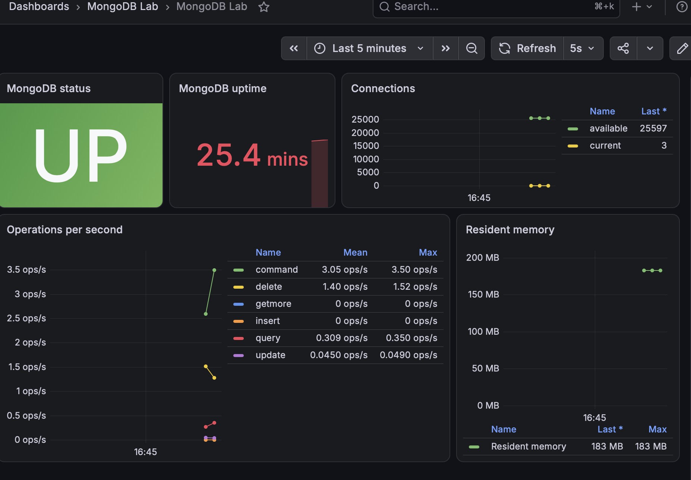
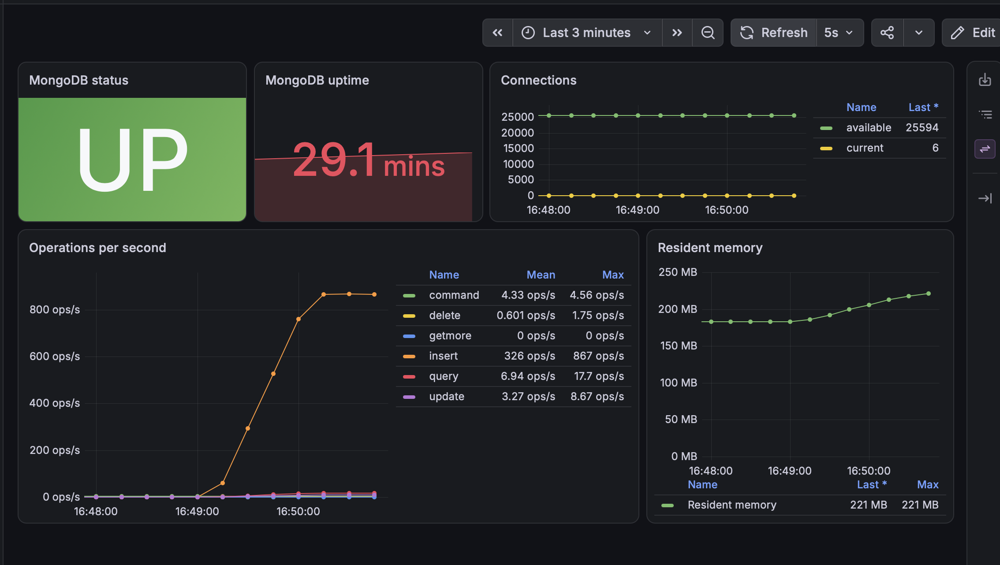

# Лабораторная работа №1 — эксплуатация MongoDB

## Как я делала эту работу

Эту лабораторную я делала на MacBook с процессором M3. Так как MongoDB нужно
было установить без Docker, я создала в VMware Fusion виртуальную машину с
Ubuntu Server 24.04 ARM64. В итоге MongoDB и мониторинг работают внутри Ubuntu,
а файлы проекта и Ansible находятся на Mac.

### Почему я решила использовать Ansible

Сначала я подключалась к Ubuntu по SSH и выполняла команды вручную. Но дальше
стало понятно, что действий слишком много: установка пакетов, изменение
конфигурации, создание пользователей, резервные копии и мониторинг. Делать всё
это руками каждый раз неудобно, и легко забыть какую-нибудь команду.

Поэтому я решила продолжить через Ansible — так это было бы ближе к реальной
настройке сервера. Mac стал управляющей машиной, а Ubuntu — сервером, к которому
Ansible подключается по SSH и запускает playbook-файлы.


Копировать весь репозиторий на VM при этом не пришлось: Ansible сам передаёт
только нужные файлы. Пароли я убрала в зашифрованный `vault.yml`, а сам файл
добавлен в `.gitignore`, поэтому настоящих паролей в Git нет.

### Виртуальная машина и SSH

На Ubuntu я создала пользователя `ola` с правами `sudo`. VM получила адрес
`192.168.60.133` в NAT-сети VMware. Сначала я входила по паролю, потом настроила
SSH-ключ.

С ключом тоже получилось не сразу: обычный `ssh` подключался, а Ansible получал
`Permission denied`. Ключ был защищён парольной фразой и не был добавлен в
`ssh-agent`. После добавления ключа проверка Ansible вернула:

```text
mongo-lab | SUCCESS => {
    "changed": false,
    "ping": "pong"
}
```

После ответа `pong` стало понятно, что Mac видит VM и Ansible может выполнять на
ней команды.

### Установка MongoDB

Сначала я сразу попробовала выполнить `sudo apt install mongodb-org`, но APT
написал, что такого пакета нет. Оказалось, что `mongodb-org` не входит в обычные
репозитории Ubuntu. После добавления официального репозитория MongoDB 8.0 пакет
нашёлся и установился.

После установки включила автозапуск `mongod` через systemd. При первой проверке
`mongosh` вернул `ECONNREFUSED`, потому что сервер ещё не принимал подключения.
После запуска службы команда `ping` стала выполняться успешно.

Когда ручная установка заработала, я перенесла эти действия в
`playbooks/provision.yml`, чтобы настройку можно было повторить, а не вспоминать
все команды заново.

### Управление службой MongoDB

Управление службой я вынесла в `playbooks/service-demo.yml`. Он остановил
`mongod`, проверил, что порт `27017` закрылся, потом снова запустил MongoDB и
выполнил перезапуск. Там же включается автозапуск после перезагрузки Ubuntu.

Первый запуск сценария завершился ошибкой:

```text
Attempting to decrypt but no vault secrets found
```

Я сначала не добавила `--ask-vault-pass`, потому что самому управлению службой
пароль MongoDB не нужен. Но Ansible всё равно загружает общий `vault.yml` из
inventory. Повторила команду с `--ask-vault-pass`, и после этого всё прошло:

```text
mongo-lab : ok=5 changed=3 unreachable=0 failed=0
```

### Что не получилось с первого раза

`provision.yml` тоже не заработал с первого запуска. Сначала APT сообщил:

```text
Conflicting values set for option Signed-By
```

Проблема появилась из-за того, что до Ansible я уже устанавливала MongoDB
вручную. На VM остался старый файл репозитория с ключом `.gpg`, а playbook добавил
ещё один вариант с ключом `.asc`. APT увидел две разные настройки одного
репозитория. Я добавила в playbook удаление старого `.list`, и конфликт исчез.

Следующей ошибкой была проверка `mongosh`: YAML разобрал `{ ping: 1 }` не как
строку JavaScript. Я исправила кавычки, после чего проверка наконец вернула:

```text
MongoDB ping returned 1
```

### Авторизация и пароли

Все пароли MongoDB я храню в Ansible Vault. Там отдельно лежат пароли
администратора, учебных пользователей, backup, restore и exporter. В открытом
виде в репозиторий они не попадают.

`secure.yml` включает `authorization: enabled` и создаёт первого администратора
`lab_admin`. На этом шаге снова была ошибка: скрипт сначала вызывал `getUser()`,
но режим localhost exception разрешает без авторизации только сразу создать
первого пользователя. Поэтому первый `createUser()` я вынесла в отдельный
скрипт, где перед ним нет других запросов.

После исправления результат был таким:

```text
mongo-lab : ok=9 changed=2 unreachable=0 failed=0
```

После этого авторизация включилась, администратор создался, и вход под ним
прошёл успешно.

### Учебные базы, роли и пользователи

Через `configure-lab.yml` я создала базы `university` и `library`, тестовые
документы и индексы. Для лабораторной добавила свои роли:

- `universityReader` — чтение учебной базы;
- `studentEditor` — работа с коллекцией `students`;
- `gradesOnlyReader` — чтение только коллекции `grades`;
- `temporaryRole` — временная роль для демонстрации удаления.

Для этих ролей я создала отдельных пользователей. Ещё понадобились служебные
пользователи `backup_user`, `restore_user` и `mongodb_exporter`.

Результат настройки:

```text
mongo-lab : ok=9 changed=7 unreachable=0 failed=0
```

### Проверка ролевой модели

Потом запустила `playbooks/role-demo.yml`: он назначил пользователю
дополнительную роль, потом отозвал её и изменил разрешения уже существующей
роли.

Отдельно мне нужно было показать доступ только к одной коллекции.
`grades_reader` смог прочитать `university.grades`, но не смог прочитать
`university.students`. То есть доступ не открылся сразу ко всей базе. В выводе
это выглядело так:

```text
Access to university.students was denied as expected.
```

В конце сценарий удалил временного пользователя и временную роль:

```text
Deleted user temporary_user
Deleted role temporaryRole
```

Сценарий завершился без ошибок:

```text
mongo-lab : ok=10 changed=3 unreachable=0 failed=0
```

### Резервные копии

Копии я делала через `playbooks/backup.yml`. Внутри запускается `mongodump` от
отдельного пользователя `backup_user`. В имя каждой копии добавляется дата и
время, чтобы следующий запуск не затёр предыдущий.

С первого раза backup прошёл только наполовину: отдельная копия `university`
создалась, а общая копия закончилась с `failed=1`. Я использовала параметр
`--nsInclude`, но он есть у `mongorestore`, а у `mongodump` его нет.

Я переделала этот шаг: теперь `university` и `library` по очереди копируются в
один общий каталог. После исправления появились такие каталоги:

```text
/var/backups/mongodb-lab/20261017T132635Z-university
/var/backups/mongodb-lab/20261017T132635Z-all-study-dbs
```

Повторный запуск завершился успешно:

```text
mongo-lab : ok=9 changed=5 unreachable=0 failed=0
```

Потом запустила тот же playbook ещё раз, чтобы проверить, что старая копия не
перезапишется. Команда `ls -1 /var/backups/mongodb-lab` показала:

```text
20261017T132350Z-university
20261017T132635Z-all-study-dbs
20261017T132635Z-university
20261017T132806Z-all-study-dbs
20261017T132806Z-university
```

`132350Z-university` остался от первой неудачной попытки. А пары `132635Z` и
`132806Z` — это уже две полные копии. По разным именам видно, что новая копия не
перезаписала старую.

### Восстановление коллекции

Восстановление проверила через `playbooks/restore-demo.yml`. Я не хотела сначала
удалять коллекцию, а потом выяснять, что копия пустая, поэтому playbook сначала
находит свежий backup и проверяет наличие файла `students`. Только после этой
проверки он удаляет `university.students` и восстанавливает её через
`mongorestore`.

```text
Restored university.students from
/var/backups/mongodb-lab/20261017T132806Z-university;
document count is 3.
```

После восстановления снова было 3 документа — столько же, сколько до удаления:

```text
mongo-lab : ok=14 changed=5 unreachable=0 failed=0
```

### Мониторинг

Мониторинг собрала из трёх частей: Percona MongoDB Exporter получает показатели
из MongoDB, Prometheus их собирает, а Grafana строит графики.

Для дашборда выбрала следующие показатели:

- доступность MongoDB;
- время работы сервера;
- текущие и доступные подключения;
- количество операций в секунду;
- объём занятой оперативной памяти.

С мониторингом было несколько мелких ошибок. Сначала exporter и Prometheus уже
отвечали, а Grafana вернула `Connection refused`: при первом запуске она просто
не успела открыть порт `3000`. Я добавила ожидание портов `9216`, `9090` и `3000`
до 90 секунд.

После этого все три адреса отвечали, но моя проверка искала строго
`mongodb_up 1`. На самом деле exporter отдавал строку с дополнительной меткой:

```text
mongodb_up{cluster_role="mongod"} 1
```

Значение `1` означало, что всё работает, просто проверка была слишком строгой. Я
исправила регулярное выражение, и она прошла:

```text
mongo-lab : ok=1 changed=0 unreachable=0 failed=0
```

В Grafana после этого всё равно сначала была заполнена только панель
`MongoDB status`, а остальные показывали `No data`. Оказалось, что exporter 0.53
по умолчанию не собирает диагностические метрики. Я добавила в systemd-службу
`--collector.diagnosticdata`, перезапустила exporter, и остальные графики тоже
появились.

### Нагрузочное тестирование

Чтобы проверить графики, я запустила `playbooks/load.yml`. Две минуты он добавлял,
читал, изменял и удалял документы в отдельной тестовой коллекции
`university.load_test`. Обычные учебные данные при этом не менялись.

До запуска нагрузки было 3 текущих подключения, MongoDB использовала примерно
183 MB памяти. Во время теста на графиках были видны следующие изменения:

- текущие подключения выросли до 6;
- скорость вставки достигла 867 операций в секунду;
- запросы достигли 17,7 операций в секунду;
- обновления достигли 8,67 операций в секунду;
- удаления достигли 1,75 операции в секунду;
- используемая память выросла примерно до 221 MB.

Панель состояния всё это время показывала `UP`, то есть MongoDB не перестала
отвечать во время нагрузки.

Дашборд до запуска нагрузки:



Дашборд во время нагрузки:



### Итог

В итоге я развернула MongoDB без Docker, настроила её автозапуск и авторизацию,
разобралась с ролями, сделала резервные копии и восстановление, а потом
подключила мониторинг и посмотрела поведение базы под нагрузкой. Самое полезное
для меня в этой работе — не просто получить успешный запуск, а разобраться с
ошибками APT, Vault и `mongodump`, а также с настройкой метрик exporter.
