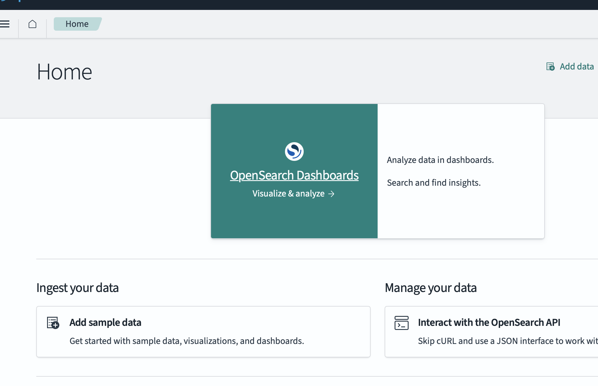
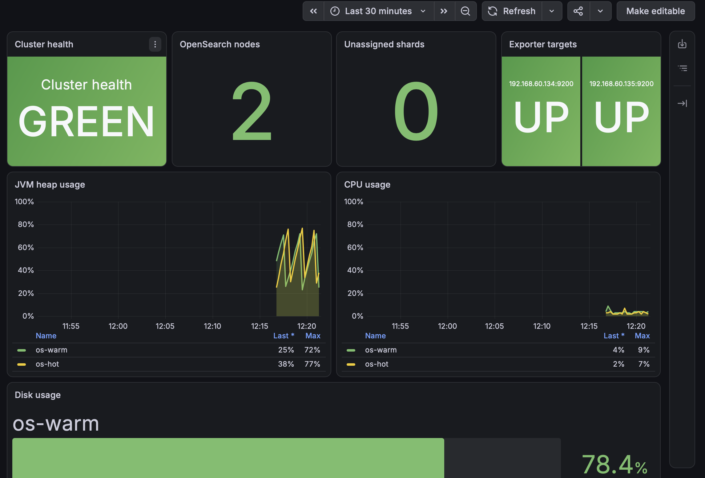

# Лабораторная работа №2 — OpenSearch 3.8

В этой работе я разворачиваю защищённый кластер OpenSearch 3.8 из двух узлов. Свежие логи сначала попадают на hot-узел, а после rollover переносятся на warm-узел.

## Схема

```text
Nginx -> Fluent Bit -> logs-nginx data stream
                         |
                         v
                    os-hot -> os-warm -> удаление

OpenSearch -> Prometheus -> Grafana
```

## Что уже сделано

Я создала две виртуальные машины с Ubuntu Server 24.04 ARM64 в VMware Fusion. Для них заданы разные hostname и сетевые адреса:

- `os-hot` — `192.168.60.135`;
- `os-warm` — `192.168.60.134`.

На обеих машинах установлен и включён OpenSSH Server. Для этой работы я создала отдельный SSH-ключ, чтобы Ansible не запрашивал пароль при каждом подключении.

## Подготовка серверов

Для первоначальной настройки серверов я подготовила Ansible playbook `playbooks/prepare.yml`. Он устанавливает базовые пакеты, прописывает имена обоих узлов, отключает swap и выставляет параметр `vm.max_map_count`, который нужен OpenSearch.

### Проблема с `sudo` при первом запуске Ansible

При первом запуске playbook Ansible смог подключиться к обеим виртуальным машинам по SSH, но остановился уже на сборе системной информации с ошибкой:

```text
Timeout (12s) waiting for privilege escalation prompt
```

Сначала я решила, что Ansible не хватает пароля для `sudo`, поэтому попробовала запустить playbook с ключом `-K`. Ansible запросил пароль, но ошибка осталась такой же.

После этого я отдельно проверила пользователя `ola`. На обеих машинах он входит в группу `sudo`, а команда `sudo -n whoami` возвращает `root`. Это означало, что беспарольный `sudo` уже работает и проблема на самом деле не связана с паролем.

Дальше я измерила время выполнения `sudo` и увидела, что каждая команда ждёт примерно 15 секунд. Ansible, в свою очередь, переставал ждать уже через 12 секунд. Причиной задержки оказалось старое имя виртуальной машины в файле `/etc/hosts`. Обе машины были созданы клонированием базовой VM, поэтому в файле осталось имя `opensearch-base`, хотя текущие hostname уже были изменены на `os-hot` и `os-warm`.

На каждой машине я исправила строку с локальным именем:

```text
# os-hot
127.0.1.1 os-hot

# os-warm
127.0.1.1 os-warm
```

Перед изменением я сохранила резервную копию исходного файла под именем `/etc/hosts.before-opensearch-lab`.

После исправления `sudo` стал выполняться без задержки, а проверка Ansible с повышением привилегий успешно вернула пользователя `root`. Затем я ещё раз запустила playbook, уже без ключа `-K`:

```bash
ansible-playbook playbooks/prepare.yml
```

Playbook успешно выполнился на обеих машинах. В результате:

- установлены базовые административные пакеты;
- в `/etc/hosts` добавлены адреса обоих узлов;
- swap отключён;
- параметр `vm.max_map_count` установлен в `262144`;
- недоступных узлов и завершившихся с ошибкой задач нет.

Я также запустила playbook повторно. Он завершился с `changed=0`, то есть повторный запуск не внёс лишних изменений. Это подтверждает, что подготовка серверов описана идемпотентно.

## Установка OpenSearch

Для установки OpenSearch я подготовила отдельный playbook `playbooks/install_opensearch.yml`. Так как обе виртуальные машины работают на ARM64, в playbook есть отдельная проверка архитектуры. Я также отключила установку стандартной demo-конфигурации Security plugin, потому что дальше для кластера будут созданы свои сертификаты и свой центр сертификации.

### Пакет OpenSearch не нашёлся в APT-репозитории

Сначала я попробовала установить OpenSearch 3.8.0 из официального APT-репозитория. Репозиторий и ключ добавились без ошибок, но на этапе установки обе машины вернули сообщение:

```text
No package matching 'opensearch' is available
```

Причиной оказалась архитектура виртуальных машин. В APT-репозитории пакет `opensearch` для ARM64 не появился в списке доступных пакетов. При этом OpenSearch отдельно публикует готовый Debian-пакет для ARM64.

Я изменила способ установки. Теперь playbook скачивает файл `opensearch-3.8.0-linux-arm64.deb` и его отдельную цифровую подпись с официального сайта OpenSearch. Перед установкой подпись проверяется официальным GPG-ключом. Только после успешной проверки Ansible устанавливает пакет. Оставшийся после первой попытки APT-репозиторий удаляется, чтобы он не мешал будущим обновлениям системы.

После этого я повторно запустила playbook. На этот раз установка успешно завершилась на обеих виртуальных машинах. На `os-hot` и `os-warm` установлена одинаковая версия OpenSearch 3.8.0. Сервис добавлен в автозагрузку, но пока специально оставлен остановленным. Сначала я настрою собственный центр сертификации и TLS для транспортного и REST-уровней, и только после этого буду запускать кластер. Так OpenSearch ни разу не будет запущен с временной или небезопасной конфигурацией.

## Настройка собственного TLS

Для защищённого соединения я создала свой учебный центр сертификации и выпустила отдельные сертификаты для `os-hot`, `os-warm` и администратора. Сертификаты узлов содержат их DNS-имена и IP-адреса. Благодаря этому узлы не только шифруют трафик, но и проверяют, что подключаются именно к нужному участнику кластера.

Закрытый ключ центра сертификации хранится только локально в каталоге `files/pki` и исключён из Git. На каждую виртуальную машину передаётся публичный сертификат CA, сертификат конкретного узла и его закрытый ключ. Административный сертификат копируется только на `os-hot`, откуда выполняется настройка Security plugin.

Ansible включает TLS сразу на двух уровнях: транспортный порт `9300` используется для общения узлов между собой, а HTTPS-порт `9200` используется клиентами и REST API. Одновременно узлам назначаются атрибуты `hot` и `warm`, которые позже понадобятся политике перемещения индексов.

### `securityadmin.sh` не смог найти Java

При первом запуске TLS-playbook оба узла запустились и открыли HTTPS-порт, но инициализация Security plugin завершилась с кодом `127`. Утилита вывела сообщение:

```text
WARNING: nor OPENSEARCH_JAVA_HOME nor JAVA_HOME is set
```

Проблема была не в сертификатах. У OpenSearch есть собственная Java в каталоге `/usr/share/opensearch/jdk`, но неинтерактивная Ansible-сессия не передала утилите путь к ней. Я добавила для задачи запуска `securityadmin.sh` переменную `OPENSEARCH_JAVA_HOME=/usr/share/opensearch/jdk`. После этого утилита может использовать встроенную Java и продолжить инициализацию Security plugin.

После исправления пути к Java утилита запустилась, но сообщила, что не видит OpenSearch по адресу `os-hot:9300`. Сам сервис при этом уже работал, а HTTPS-порт `9200` успешно прошёл проверку. Причиной оказалось локальное разрешение имени: внутри VM имя `os-hot` также связано с адресом `127.0.1.1`, тогда как OpenSearch слушает стандартный loopback-адрес `127.0.0.1` и основной адрес `192.168.60.135`.

Для локальных административных операций я заменила имя `os-hot` на явный адрес `127.0.0.1`. Этот адрес заранее добавлен в SAN сертификата узла, поэтому проверка TLS остаётся полноценной и отключать проверку имени сертификата не требуется.

### `securityadmin.sh` подключался не к тому порту

После исправления адреса утилита смогла соединиться с `127.0.0.1:9300`, но OpenSearch сразу закрыл соединение с ошибкой `ConnectionClosedException`. Причина была в неверно выбранном порте. Порт `9300` предназначен для внутреннего транспортного протокола между узлами, а `securityadmin.sh` в OpenSearch 3.8 работает через HTTPS/REST API.

В playbook я заменила порт `9300` на `9200`. TLS при этом не отключается: утилита по-прежнему проверяет центр сертификации и предъявляет отдельный административный сертификат.

После этой замены playbook завершился успешно. Security plugin создал свой системный индекс и загрузил в него начальную конфигурацию. Защищённый запрос состояния кластера также выполнился успешно. Это подтверждает, что REST-уровень работает через HTTPS, а кластер принимает административный сертификат, выданный нашим центром сертификации.

## Подготовка OpenSearch Dashboards

Для завершения первой части работы я подготовила установку OpenSearch Dashboards 3.8.0 на `os-hot`. Для ARM64 будет скачан отдельный Debian-пакет с официального сайта. Как и при установке OpenSearch, перед установкой Ansible проверит цифровую подпись пакета.

Для веб-интерфейса используется отдельный серверный сертификат с DNS-именем `os-hot` и IP-адресами `192.168.60.135` и `127.0.0.1`. Поэтому трафик от браузера до Dashboards также будет зашифрован. Dashboards подключается к OpenSearch по HTTPS и в режиме `full` проверяет как цепочку доверия, так и имя в сертификате узла.

Для служебного соединения с OpenSearch будет создан пользователь `kibanaserver` со встроенной ролью `kibana_server`. Это не учётная запись для входа человека, а технический пользователь, от имени которого Dashboards создаёт свои служебные индексы. Его пароль также хранится в Ansible Vault.

### Проверка Dashboards получила `401 Unauthorized`

При первом запуске Dashboards открыл порт `5601`, но Ansible долго повторял запрос к `/api/status`, а затем завершился с ошибкой `401 Authentication required`. Это не означало, что Dashboards не запустился. Наоборот, HTTPS-сервис уже отвечал, а Security plugin правильно не пускал неаутентифицированный запрос.

Ошибка была в логике самой Ansible-проверки: она считала успехом только ответ `200`. Я изменила проверку: `503` означает, что нужно ещё подождать, а `200` или защищённый ответ `401` подтверждают, что веб-приложение уже работает и требует вход.

Прямой адрес виртуальной машины `https://192.168.60.135:5601` с Mac не открывался. При этом сам сервис внутри `os-hot` уже работал, поэтому для доступа я использовала SSH-туннель и открыла `https://127.0.0.1:5601` на Mac. В результате появилась страница входа OpenSearch Dashboards. Это подтвердило, что Dashboards развёрнут, HTTPS включён, а Security plugin требует аутентификацию.

## Хранение паролей в Ansible Vault

Для трёх будущих пользователей OpenSearch нужны пароли, но хранить их открытым текстом в inventory или playbook небезопасно. Я создала зашифрованный файл `inventories/lab/group_vars/all/vault.yml` и записала в него три разных секрета: для пользователя записи, чтения и мониторинга.

Обычный файл `main.yml` содержит только имена пользователей и ссылки на Vault-переменные. Сами пароли в открытом виде в Git не попадают. При ручном запуске Ansible я передаю пароль от Vault через `--ask-vault-pass`. В промышленной среде его обычно получают автоматически из AWX, CI/CD или отдельного хранилища секретов.

## Ролевая модель

После настройки TLS я подготовила playbook `playbooks/configure_security_roles.yml`, который создаёт три отдельные роли и трёх пользователей. Для изменения ролей и пользователей Ansible обращается к Security REST API по HTTPS и предъявляет административный TLS-сертификат. Обычным пользователям административные права не выдаются.

Роль `logs_writer_role` предназначена для перекладчика логов. Она разрешает индексирование и bulk-запросы только для data stream `logs-nginx`. Прав на чтение логов и удаление документов у неё нет. Роль `logs_reader_role` даёт только чтение объектов, имя которых совпадает с `logs*`. Роль `opensearch_monitor_role` не имеет индексных прав и может только читать состояние, статистику и информацию о кластере и узлах.

Пользователю `logs_reader` дополнительно назначается встроенная роль `kibana_user`. Она нужна только для входа и работы с интерфейсом OpenSearch Dashboards. Доступ к самим данным по-прежнему определяет моя роль `logs_reader_role`, поэтому пользователь может читать только `logs*`. Служебную роль `kibana_server` человеку я не выдаю: она предназначена только для технической учётной записи `kibanaserver`.

Пароли получаются из Ansible Vault. Задачи, в которых пароли передаются Security API и проверяются аутентификацией, помечены `no_log: true`, поэтому значения не выводятся в терминал.

### Security API отклонил создание пользователей

Роли создались успешно, но при создании всех трёх пользователей Security API вернул `400 Bad Request`. Из-за `no_log: true` Ansible специально скрыл тело запросов и ответов, чтобы пароль случайно не появился в терминале. Сам формат запроса соответствовал API OpenSearch, поэтому одинаковая ошибка для всех пользователей указывала на проверку стойкости паролей.

OpenSearch проверяет не только длину пароля, но и его сложность и предсказуемость. Первоначальная Ansible-проверка смотрела только на длину от 12 символов, поэтому пропускала пароли, которые затем отклонял OpenSearch. Я усилила предварительную проверку: теперь требуется не менее 16 символов, буквы в обоих регистрах, цифра и специальный символ. При этом пароль всё равно должен быть непредсказуемым, потому что Security plugin дополнительно оценивает его стойкость. Сами значения остаются только в Ansible Vault.

После замены трёх паролей на более стойкие я повторно запустила playbook. Он успешно создал пользователей, выполнил вход от имени каждого из них и проверил полученные роли. `logs_writer` получил только право записи в `logs-nginx`, `logs_reader` — доступ к Dashboards и чтение `logs*`, а `opensearch_monitor` — только чтение метрик кластера и узлов. Play завершился без ошибок: `failed=0`, `unreachable=0`.

После этого я вошла в OpenSearch Dashboards под пользователем `logs_reader`. Открылась главная страница интерфейса, значит цепочка целиком работает: браузер подключается к Dashboards по HTTPS, Dashboards обращается к защищённому OpenSearch через служебного пользователя, а Security plugin отдельно аутентифицирует пользователя чтения и применяет его роли.



## Подготовка сбора и хранения логов Nginx

Для третьей части лабораторной я подготовила playbook `playbooks/configure_log_pipeline.yml`. Nginx и Fluent Bit будут установлены на `os-hot`, потому что у этого узла больше оперативной памяти. Nginx раздаёт небольшую тестовую страницу и записывает каждый запрос в отдельный access-лог в формате JSON. В запись входят время, IP-адрес клиента, HTTP-метод, URI, статус ответа, количество отправленных байтов, время обработки, Referer и User-Agent.

Fluent Bit устанавливается из официального подписанного репозитория. Перед добавлением репозитория Ansible сверяет fingerprint его GPG-ключа, поэтому случайно подменённый ключ не будет принят. Fluent Bit читает JSON-файл как поток: он запоминает позицию в файле и после перезапуска продолжает с нужного места. В OpenSearch он подключается по HTTPS, проверяет сертификат через мой корневой CA и авторизуется как `logs_writer`. Пароль берётся из Ansible Vault и попадает только в закрытый конфигурационный файл на виртуальной машине с правами `0600`; в Git и вывод Ansible он не записывается. Запись выполняется операцией `create`, которая подходит для append-only data stream.

Перед запуском Fluent Bit playbook создаёт шаблон `logs-nginx-template` и data stream `logs-nginx`. Шаблон задаёт типы полей, один primary shard без replica и размещение нового write index на узле с атрибутом `temp=hot`. Отсутствие replica здесь осознанное: в лаборатории есть только по одному узлу каждого уровня, а жёсткое размещение одновременно primary и replica на единственном hot-узле оставило бы replica неназначенной.

Политика `logs-nginx-hot-warm-delete` выполняет полный цикл hot–warm–delete. Пока backing index является активным, он находится на `os-hot`. Rollover создаёт новый write index, когда старому исполнится 1 минута или размер primary shards достигнет 1 МБ — срабатывает первое наступившее условие. После rollover старый индекс переносится на `os-warm`, а при достижении возраста 10 минут удаляется. Пустые индексы специально не ротируются, чтобы кластер не создавал новый backing index каждую минуту без входящих логов.

ISM проверяет условия периодически, а не непрерывно. Стандартный интервал выполнения политик равен пяти минутам, что слишком долго для демонстрации с минутным rollover. Поэтому для лаборатории интервал выполнения политик уменьшен до одной минуты, а случайная задержка отключена. Фактическое действие может произойти не точно в секунду достижения порога, а во время ближайшей проверки ISM.

### OpenSearch не разрешил уменьшить служебный ISM sweep до одной минуты

При первом запуске настройка ISM остановилась с ответом `400 Bad Request`: для параметра `plugins.index_state_management.coordinator.sweep_period` OpenSearch 3.8 разрешает значение не меньше пяти минут. Я пыталась уменьшить его до одной минуты, чтобы быстрее увидеть применение политики, но это противоречило встроенному ограничению OpenSearch.

Я убрала недопустимую настройку. Интервал выполнения уже назначенных политик остался равным одной минуте, а служебный coordinator sweep работает с разрешённым интервалом. Чтобы при первом запуске не ждать очередного пятиминутного сканирования, playbook явно привязывает политику к первому backing index через ISM API. Для новых backing-индексов в самой политике остаётся `ism_template`, поэтому они также автоматически попадают под управление. Дополнительно playbook запускает безопасную симуляцию политики и проверяет, что индекс начинает работу в состоянии `hot` с действием `rollover`.

### Создание data stream не успело ответить за 30 секунд

Следующий запуск дошёл до создания `logs-nginx`, но модуль Ansible прекратил ожидание через стандартные 30 секунд и показал `The read operation timed out`. Это не обязательно означает отказ операции: создание первого data stream одновременно создаёт его первый backing index, применяет шаблон и размещает shard, поэтому на небольших виртуальных машинах ответ может прийти позже. Сам OpenSearch при этом мог продолжить создание после того, как клиент уже перестал ждать.

Я добавила отдельную проверку, что оба узла кластера доступны и состояние кластера не красное. Для операции создания увеличила таймаут до 180 секунд, а чтение результата теперь повторяется несколько раз. Повторный запуск безопасен: если OpenSearch успел создать data stream после прошлого таймаута, playbook увидит существующий объект и не будет создавать его второй раз.

### После перевода времени кластер стал красным

При следующем запуске оба узла были доступны, но проверка остановила playbook, потому что состояние кластера стало `red`. В кластере оставалось пять неназначенных шардов. Попытка посмотреть их через API возвращала необычную ошибку `duration cannot be negative`.

Я сравнила системное время на обеих виртуальных машинах. Часы уже были синхронизированы через NTP и показывали одинаковое UTC-время, но до этого они были переведены назад примерно на три часа. OpenSearch успел сохранить в состоянии кластера отметки времени из «будущего», поэтому при вычислении длительности получал отрицательное число.

Я не стала принудительно назначать пустые primary shards, потому что такая операция может привести к потере данных. Вместо этого выполнила безопасный повтор ранее неудавшихся назначений через Cluster Reroute API с параметром `retry_failed=true`. Запрос был принят, primary shard первого backing index перешёл в состояние `STARTED` и правильно разместился на `os-hot`.

### OpenSearch заблокировал индекс из-за заполненного диска

В ответе Cluster Reroute я увидела ещё одну причину проблемы: на `.ds-logs-nginx-000001` был установлен блок `read_only_allow_delete`. OpenSearch включает такую защиту при достижении дискового порога `flood_stage`, чтобы полностью заполненный диск не повредил работу узла.

Проверка показала, что маленький системный диск `os-hot` был заполнен на 96%: из 9,8 ГБ свободными оставались только 441 МБ. Я сначала рассматривала увеличение виртуального диска, но перед этим проверила размеры каталогов. Оказалось, что `/var/cache` занимал около 1,4 ГБ. Это были сохранённые копии уже установленных пакетов, поэтому я безопасно очистила их командой `apt-get clean`. Установленные OpenSearch и Dashboards, их настройки и данные при этом не удаляются. После очистки занятое место уменьшилось до 82%, поэтому расширять диск не пришлось.

Сразу после очистки Linux уже видел 1,8 ГБ свободного места, а OpenSearch продолжал показывать старые 440 МБ и снова устанавливал блокировку. Настройки порогов были стандартными: `low` — 85%, `high` — 90%, `flood_stage` — 95%, обновление статистики — раз в 30 секунд. Значит, проблема была не в порогах, а в зависшем после перевода часов внутреннем расписании обновления.

Я перезапустила только службу OpenSearch на `os-hot`. Данные и конфигурация сохранились, а после запуска узел увидел реальные 82% заполнения. Неназначенные реплики распределились между узлами, защитная блокировка перестала возвращаться, и кластер снова смог принимать записи.

### Результат настройки конвейера логов

После исправления времени и диска я снова запустила `configure_log_pipeline.yml`. Playbook завершился без ошибок. Nginx раздаёт тестовую страницу на порту `80` и пишет обращения в JSON-формате. Fluent Bit прочитал этот файл и отправил первые три документа в data stream `logs-nginx` от имени пользователя `logs_writer`.

Первый backing index `.ds-logs-nginx-000001` находится на hot-узле и управляется политикой `logs-nginx-hot-warm-delete`. Проверка ISM показала начальное состояние `hot` и текущее действие `rollover`. Индекс ротируется по первому наступившему условию: возраст одна минута или размер 1 МБ. После rollover закрытая часть потока переносится на warm-узел, а по достижении возраста 10 минут удаляется.

### Проверка реального rollover, переноса и удаления

Чтобы проверить не только настройки, но и реальную работу всей цепочки, я создала тестовые обращения к странице Nginx и дала Fluent Bit время передать их в OpenSearch. После этого data stream показал `generation: 3`. В нём остались `.ds-logs-nginx-000002` и `.ds-logs-nginx-000003`, а самый первый индекс `.ds-logs-nginx-000001` уже отсутствовал. Это подтвердило, что rollover действительно создаёт новые поколения, а старый индекс удаляется по истечении срока хранения.

Отдельно через `_cat/shards` я проверила физическое размещение оставшихся индексов. Текущий write index `.ds-logs-nginx-000003` находился на `os-hot`, а предыдущий `.ds-logs-nginx-000002` — на `os-warm`. Оба primary shard были в состоянии `STARTED`, а сам data stream имел состояние `GREEN`. Таким образом, на практике подтверждена вся требуемая последовательность: новые логи записываются на hot-узел, после rollover старый индекс переносится на warm-узел, а затем удаляется.

## Подготовка мониторинга

Для четвёртой части работы я использую официальный OpenSearch Prometheus Exporter. Это плагин, который работает внутри OpenSearch и добавляет защищённый endpoint `/_prometheus/metrics` на существующем HTTPS-порту `9200`. Версия плагина должна точно соответствовать версии OpenSearch, поэтому для OpenSearch 3.8.0 используется exporter 3.8.0.0. Плагин устанавливается на оба узла: каждый endpoint отдаёт локальные показатели своего узла, а Prometheus позже будет опрашивать их по отдельности.

Доступ к метрикам не делается анонимным. В роль уже созданного пользователя `opensearch_monitor` добавляется только действие `cluster:monitor/prometheus/metrics`. Prometheus будет подключаться с этой учётной записью по HTTPS и проверять сертификаты через мой корневой CA. Пароль по-прежнему берётся из Ansible Vault.

Подробные метрики каждого индекса я отключила, потому что для оценки здоровья двухузлового учебного кластера они не нужны и создают много временных рядов. Плагин будет отдавать состояние кластера, число узлов и шардов, JVM heap, CPU, свободное место на диске, HTTP/transport и circuit breakers. Именно из этих показателей позже будет собран Grafana-дашборд.

Playbook установки exporter завершился успешно на обоих узлах. После последовательного перезапуска каждый узел вернулся в кластер, а защищённый endpoint ответил пользователю `opensearch_monitor`. Автоматическая проверка нашла в ответе метрики здоровья кластера, использования JVM heap и свободного места. Значит, плагин не просто установлен, а действительно отдаёт нужные данные с `os-hot` и `os-warm`.

Prometheus и Grafana не нужно дублировать на каждом OpenSearch-узле. Exporter работает на обоих узлах, один Prometheus опрашивает оба endpoint и хранит временные ряды, а одна Grafana строит общий дашборд. Для этой лаборатории сервисы мониторинга размещаются на `os-warm`, потому что после установки Dashboards на `os-hot` у warm-узла осталось больше свободного диска. Оба веб-интерфейса будут слушать только `127.0.0.1`; с Mac доступ к Grafana выполняется через SSH-туннель.

### Результат установки Prometheus и Grafana

Для входа в Grafana я добавила в Ansible Vault отдельный пароль администратора. Использовать для этого пользователей OpenSearch неправильно: роли `logs_writer`, `logs_reader` и `opensearch_monitor` действуют только внутри OpenSearch, а Grafana является отдельным приложением со своей авторизацией. При этом Prometheus обращается к защищённым endpoint OpenSearch именно от имени `opensearch_monitor`, поэтому ему не выдаются лишние права на чтение или изменение логов.

Playbook `configure_monitoring.yml` успешно установил Prometheus и Grafana на `os-warm`. Prometheus настроен на опрос двух адресов: `os-hot:9200` и `os-warm:9200`. Соединение выполняется по HTTPS с проверкой моего корневого сертификата. Автоматическая проверка после запуска подтвердила, что обе цели имеют состояние `UP`, то есть метрики действительно поступают с двух узлов.

Grafana также запустилась без ошибок. В неё автоматически добавлен источник данных Prometheus и загружен дашборд `OpenSearch Laboratory Monitoring`. Prometheus хранит учебные метрики не более одного дня и использует не более 256 МБ диска, чтобы мониторинг не заполнил небольшую виртуальную машину. Веб-интерфейсы слушают только локальный адрес `127.0.0.1`, поэтому наружу они не выставлены и открываются с Mac через SSH-туннель.



На скриншоте видно реальное состояние кластера после настройки мониторинга. Кластер находится в состоянии `GREEN`, OpenSearch видит оба узла, неназначенных шардов нет, а обе цели exporter имеют состояние `UP`. Это означает, что Prometheus успешно получает метрики с `os-hot` и `os-warm`.

Загрузка CPU в момент проверки была низкой. График JVM heap имеет пилообразную форму: память постепенно заполняется, затем освобождается сборщиком мусора. Для Java-приложения это нормальное поведение, однако временные максимумы 72% на `os-warm` и 77% на `os-hot` показывают, почему за heap важно наблюдать. Заполнение диска `os-warm` составляло 78,4%, то есть оставалось ниже порога предупреждения 85%.

### Почему я выбрала именно эти метрики

Я не стала выводить на дашборд все метрики exporter подряд. Их очень много, а большое количество графиков усложняет поиск реальной проблемы. Я выбрала небольшой набор, который отвечает на два главных вопроса: работает ли кластер правильно и хватает ли узлам ресурсов для нормальной производительности.

`opensearch_cluster_status` показывает общее состояние кластера. Значение `0` соответствует зелёному состоянию, `1` — жёлтому, `2` — красному. Это основной итоговый индикатор: красное состояние означает потерю доступности хотя бы одного primary shard, а жёлтое указывает на неназначенные replica shards.

Метрика Prometheus `up{job="opensearch"}` показывает, смог ли Prometheus получить метрики с каждого узла. Она нужна отдельно от состояния кластера: если endpoint одного узла недоступен или сломалась аутентификация, старое значение здоровья кластера само по себе не объяснит проблему. На панели сразу видно `UP` или `DOWN` для обоих адресов.

`opensearch_cluster_nodes_number` показывает количество узлов, которые OpenSearch видит в кластере. В этой работе нормальное значение равно двум. Если оно уменьшится до одного, значит один узел вышел из кластера, даже если оставшийся узел ещё способен отвечать на запросы.

`opensearch_cluster_shards_number{type="unassigned"}` показывает количество неназначенных шардов. Я выбрала её, потому что именно проблемы с размещением шардов переводят кластер в жёлтое или красное состояние. Эта метрика помогает увидеть причину ухудшения здоровья, а не только его итоговый цвет.

`opensearch_jvm_mem_heap_used_percent` показывает использование Java heap на каждом узле. OpenSearch работает на JVM, поэтому постоянное приближение heap к пределу приводит к частым сборкам мусора, росту задержек, срабатыванию circuit breaker и в крайнем случае к остановке процесса из-за нехватки памяти. На наших небольших VM эта метрика особенно важна.

`opensearch_os_cpu_percent` показывает загрузку процессора каждого узла. Высокая загрузка в течение длительного времени может означать слишком интенсивную индексацию, тяжёлые поисковые запросы, слияние сегментов или нехватку вычислительных ресурсов. CPU вместе с JVM heap помогает отличить нехватку процессора от нехватки памяти.

Заполнение диска вычисляется по `opensearch_fs_path_total_bytes` и `opensearch_fs_path_free_bytes`. Для OpenSearch это не просто показатель свободного места: при достижении дисковых watermarks кластер ограничивает размещение шардов, а на уровне `flood_stage` переводит индексы в режим `read_only_allow_delete`. В этой лаборатории такая блокировка уже возникала на `os-hot`, поэтому график диска позволяет заранее увидеть приближение к той же проблеме.

В результате верхняя строка дашборда быстро показывает состояние кластера и доступность узлов, а графики JVM heap, CPU и диска помогают анализировать производительность и нехватку ресурсов. Пороговые цвета выбраны в соответствии с практическим смыслом показателей: для heap предупреждение начинается с 70%, критическое состояние — с 85%; для диска предупреждение начинается с 85%, а критическое состояние соответствует `flood_stage` 95%.

## Текущее состояние работы

- [x] установить OpenSearch 3.8 на оба узла;
- [x] создать свой центр сертификации и включить TLS;
- [x] развернуть OpenSearch Dashboards;
- [x] настроить роли и пользователей;
- [x] установить Nginx и Fluent Bit;
- [x] создать data stream и ISM-политику;
- [x] подключить Prometheus и Grafana.
