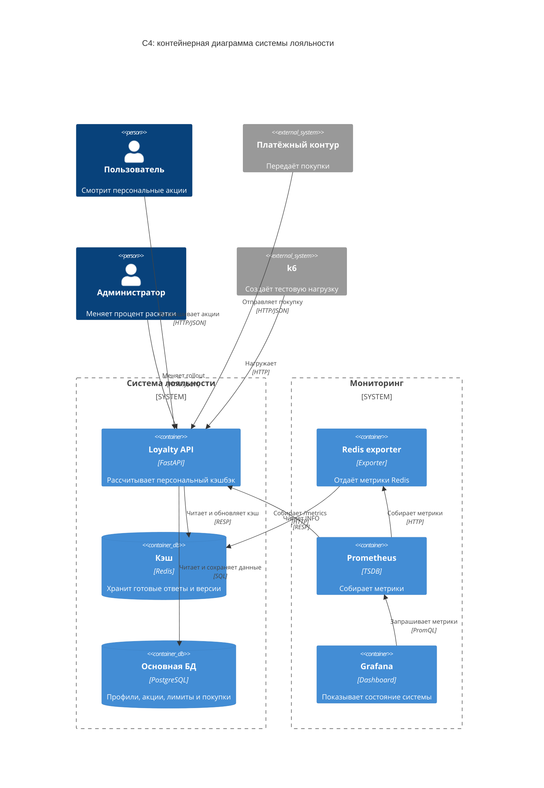

# Лабораторная работа №3 — Redis

В этой работе я сделала небольшой сервис для системы лояльности. Пользователь
заходит в приложение и видит доступные ему акции с кэшбэком. Акции показываются
не всем сразу: у каждой есть срок действия, процент раскатки и условия
таргетинга.

Я выбрала сценарий **кэширования данных основной БД**, потому что экран с
акциями открывают очень часто, а полный расчёт кэшбэка каждый раз требует читать
профиль, историю, фрод-оценку и уже потраченные лимиты.

## Что получилось

Я использовала:

- PostgreSQL как основную базу;
- Redis как быстрый кэш готового ответа;
- FastAPI для самого приложения;
- Prometheus и Grafana для мониторинга;
- k6 для нагрузочного теста;
- Docker Compose, чтобы всё запускалось одной командой.

При первом запуске создаются 1000 тестовых пользователей и четыре акции.
Процент кэшбэка зависит от уровня пользователя, срока его истории, fraud score
и оставшегося лимита. Попадание в rollout считается по хэшу `user_id` и
`offer_id`, поэтому пользователь всегда остаётся в одной и той же группе.

## Как всё работает



Когда приходит запрос на список акций, приложение сначала смотрит в Redis. Если
ответ уже есть, оно сразу возвращает его. Если ответа нет, приложение читает
данные из PostgreSQL, рассчитывает персональный кэшбэк и кладёт результат в
Redis на 60–75 секунд.

Я добавила небольшой случайный разброс TTL, чтобы много ключей не протухали в
одну секунду. Также есть короткая блокировка Redis: если несколько одинаковых
запросов одновременно не нашли кэш, тяжёлый расчёт делает только первый.

### Почему я не стала хранить лимиты только в Redis

Лимиты влияют на реальные деньги, поэтому источником истины оставила
PostgreSQL. Все покупки одного пользователя обрабатываются последовательно в
транзакции БД. Так две одновременные покупки не смогут потратить один лимит
дважды.

У каждой покупки есть `transaction_id`. Если платёжный сервис случайно отправит
её повторно, приложение вернёт старый результат и не начислит кэшбэк ещё раз.

### Как я обновляю кэш после покупки

Просто удалить ключ оказалось недостаточно: параллельный запрос мог начать
старый расчёт до удаления, а закончить после него и снова записать устаревший
ответ.

Поэтому в ключ кэша я добавила две версии:

```text
loyalty:cashback:v<версия акций>:u<id пользователя>:<версия пользователя>
```

После покупки версия пользователя увеличивается. После изменения акции
увеличивается общая версия каталога. Старый ответ после этого уже нельзя
прочитать. Удаление старого ключа и смена версии пользователя выполняются одним
Lua-скриптом Redis.

Если Redis временно недоступен, чтение не падает: приложение считает ответ
напрямую из PostgreSQL и добавляет `cache_degraded: true`.

## Запуск

```bash
cd lab3-redis
docker compose up -d --build
docker compose ps
```

После запуска доступны:

- Swagger: <http://localhost:8000/docs>;
- Prometheus: <http://localhost:9090>;
- Grafana: <http://localhost:3000>, логин и пароль `admin` / `admin`.

Проверить основной сценарий можно готовым скриптом:

```bash
./scripts/smoke-test.sh
```

Он делает первое чтение, повторное чтение из кэша, регистрирует покупку и ещё
раз читает акции. После покупки остаток лимита уменьшается, а ответ
пересчитывается.

Пример ручного запроса:

```bash
curl http://localhost:8000/api/v1/users/42/cashback
```

Изменить процент раскатки акции можно так:

```bash
curl -X PATCH http://localhost:8000/api/v1/admin/offers/1/rollout \
  -H 'Content-Type: application/json' \
  -H 'X-Admin-Key: lab-admin-key' \
  -d '{"rollout_percent": 60}'
```

## Нагрузочный тест

Я сделала смешанный тест: одновременно идут частые чтения акций и пять покупок
в секунду. Чтения постепенно доходят до 80 виртуальных пользователей.

```bash
docker compose --profile load run --rm k6
```

Результат локального запуска:

| Метрика | Результат |
|---|---:|
| Всего запросов | 106 081 |
| Средняя нагрузка | 815,7 запроса/с |
| p95 чтения | 19,38 мс |
| p95 покупки | 17,93 мс |
| Ошибки | 0% |
| Попадания в кэш | 99,13% |
| Память Redis | 1,78 МБ из 128 МБ |
| Вытесненные ключи | 0 |

Заданные пороги прошли: p95 чтения меньше 200 мс, p95 покупки меньше 500 мс,
ошибок меньше 1%. Полная короткая сводка лежит в
`docs/load-test-result.txt`.

После теста я отдельно проверила данные в PostgreSQL. Было обработано 603
уникальные покупки, превышений лимита не оказалось.

## Мониторинг

Prometheus раз в пять секунд собирает метрики приложения и Redis. Дашборд
Grafana создаётся автоматически и находится в папке **Redis Lab**. На нём я
вывела:

- долю попаданий в кэш;
- p50, p95 и p99 времени ответа;
- количество запросов;
- число операций Redis в секунду;
- память Redis;
- подключения, ошибки подключений и вытеснения ключей;
- время тяжёлого расчёта в PostgreSQL.

Это позволяет быстро понять, работает ли кэш, хватает ли Redis памяти и не
начала ли расти задержка приложения.

На общем дашборде видно результат нагрузочного теста: 99,1% запросов попали в
кэш, p95 составил 17,7 мс, Redis занял 1,33 МБ из доступных 128 МБ. Вытеснений
ключей и отклонённых подключений не было.


Отдельно я сохранила график перцентилей. Он удобнее среднего времени ответа,
потому что показывает задержку большинства запросов и редкие медленные ответы.


На графике Redis видно, что под нагрузкой число клиентов выросло примерно до
80, но ошибок подключений и вытеснений ключей всё равно не появилось.


Для сохранения этих скриншотов я подключила официальный Grafana Image Renderer.
Он не нужен для обычного запуска стенда и включается отдельным профилем:

```bash
docker compose --profile render up -d renderer grafana
```

## Что пошло не так

### Docker не был запущен

При первом запуске Compose не смог подключиться к Docker daemon. Я запустила
Docker Desktop, дождалась его готовности и повторила команду.

### Образ Grafana не скачался с первого раза

Docker Hub оборвал загрузку по таймауту. Я повторно запустила
`docker compose up -d --build`. Уже скачанные слои сохранились, поэтому второй
запуск завершился нормально.

### Grafana ругалась на отсутствующие каталоги provisioning

Grafana искала папки `plugins` и `alerting`, хотя в этой работе в них нет
настроек. Я добавила пустые каталоги с `.gitkeep`, после чего эти сообщения
исчезли.

### Нагрузочный тест создавал слишком много обычных access-логов

За две минуты k6 отправляет больше ста тысяч запросов. Uvicorn печатал строку на
каждый запрос, и полезные сообщения терялись. Я отключила только access log через
`--no-access-log`; ошибки приложения при этом продолжают выводиться.

### Первый smoke test нельзя было нормально повторять

Сначала в скрипте был жёстко задан один `transaction_id`. При повторном запуске
операция правильно считалась повторной, но тест уже не уменьшал лимит. Я убрала
фиксированный UUID: теперь FastAPI создаёт новый идентификатор, и smoke test
можно запускать несколько раз.

## Основные файлы

```text
app/                    приложение и работа с БД/Redis
compose.yml             запуск всего стенда
redis/redis.conf        настройки Redis
load/load.js            нагрузочный тест k6
monitoring/             Prometheus и Grafana
scripts/smoke-test.sh   быстрая проверка сценария
tests/                  тесты расчёта кэшбэка
```
