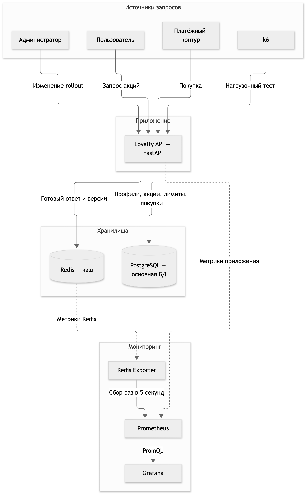
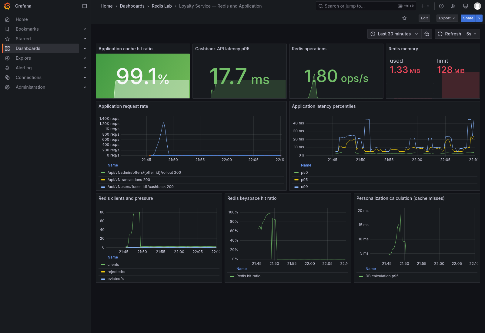
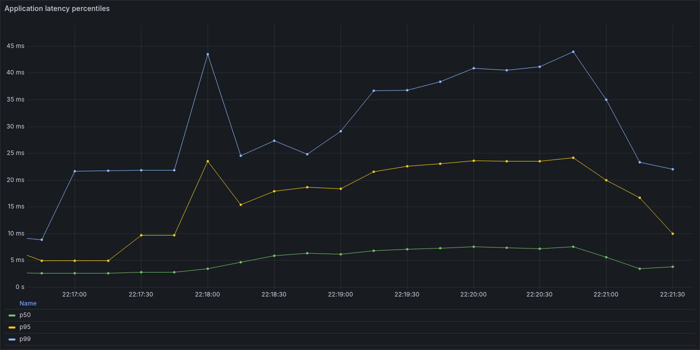
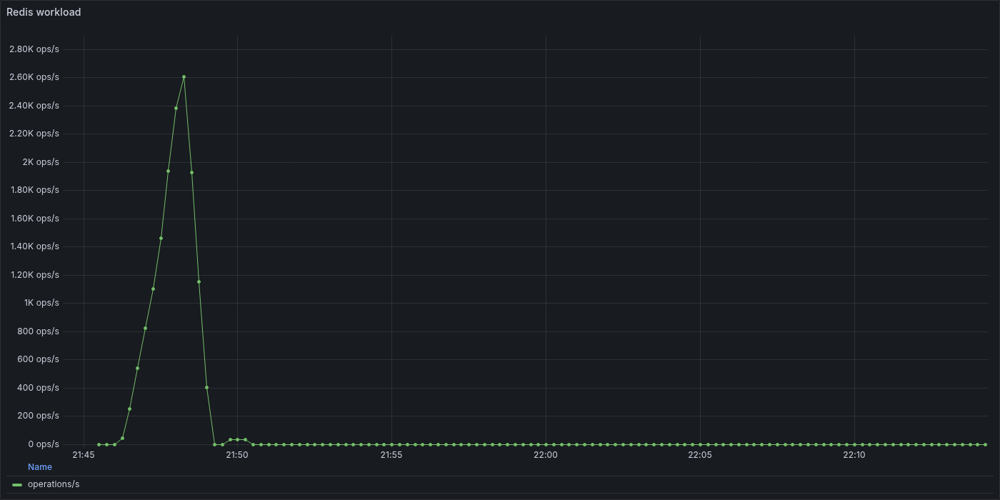
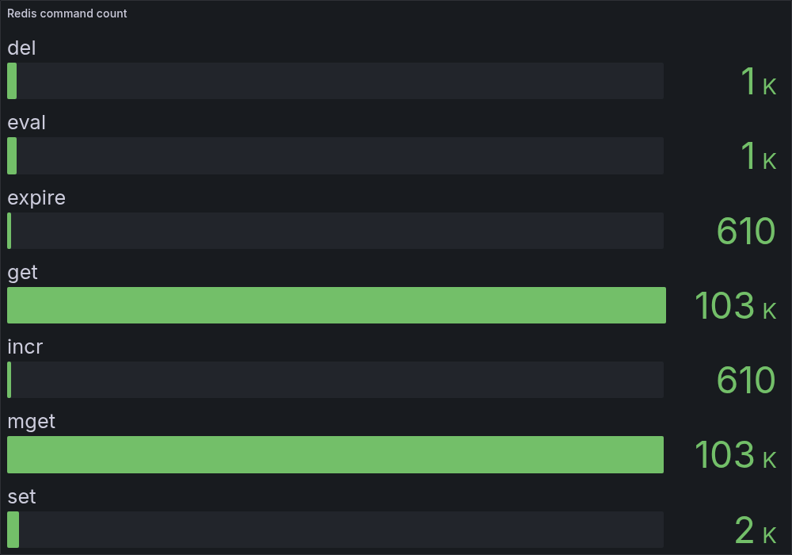
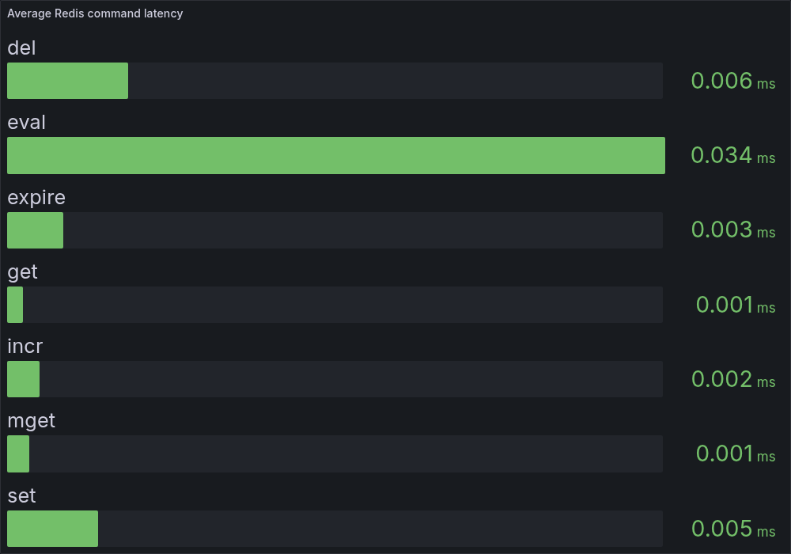

# Лабораторная работа №3 — эксплуатация Redis

## 1. Сценарий и предметная область

Я выбрала сценарий **кэширования данных основной БД** и предметную область
системы лояльности.

Пользователь видит персональные акции с кэшбэком. Акция действует ограниченное
время, раскатывается только на часть аудитории и может иметь условия по профилю,
истории операций и fraud score. Итоговый кэшбэк также зависит от уже
израсходованного лимита.

Такой экран открывают очень часто, а полный расчёт требует нескольких чтений из
основной БД. Поэтому готовый ответ выгодно кэшировать в Redis. При этом хранить
лимиты только в Redis нельзя: они меняются после каждой покупки и влияют на
реальные деньги.

## 2. Задача и требования

Задача — быстро отдавать пользователю актуальные акции, не выполняя тяжёлый
расчёт в PostgreSQL при каждом открытии экрана.

Требования к системе:

- учитывать срок акции, процент раскатки, профиль, историю и fraud score;
- учитывать персональный остаток лимита и обновлять ответ после покупки;
- оставить PostgreSQL источником истины для покупок и лимитов;
- не списывать лимит повторно, если одна транзакция пришла два раза;
- не допускать двойного расходования лимита параллельными покупками;
- переживать временную недоступность Redis без отказа чтения;
- выдерживать p95 чтения меньше 200 мс, p95 покупки меньше 500 мс и менее 1%
  ошибок;
- собирать метрики приложения и Redis, чтобы видеть не только факт нагрузки, но
  и её причину.

## 3. Архитектурная схема

Схема сделана в Mermaid и добавлена в отчёт готовой картинкой.



Loyalty API принимает запросы пользователя, покупки и изменения раскатки.
PostgreSQL хранит профили, акции, покупки и лимиты. Redis хранит готовые ответы
и версии кэша. Redis Exporter и само приложение отдают метрики в Prometheus, а
Grafana строит по ним дашборд.

## 4. Развёртывание Redis и компонентов

Стенд запускается через Docker Compose. В него входят:

- FastAPI-приложение;
- Redis 7.4;
- PostgreSQL 16;
- Redis Exporter;
- Prometheus;
- Grafana;
- k6 для нагрузочного теста.

```bash
cd lab3-redis
docker compose up -d --build
docker compose ps
```

После запуска доступны Swagger на <http://localhost:8000/docs>, Prometheus на
<http://localhost:9090> и Grafana на <http://localhost:3000>. Логин и пароль
Grafana: `admin` / `admin`.

## 5. Минимально работающее приложение

В приложении реализованы основные операции:

| Метод | Назначение |
|---|---|
| `GET /api/v1/users/{user_id}/cashback` | получить персональные акции |
| `POST /api/v1/transactions` | зарегистрировать покупку и изменить лимит |
| `PATCH /api/v1/admin/offers/{offer_id}/rollout` | изменить процент раскатки |
| `GET /health` и `GET /metrics` | проверить состояние и получить метрики |

Для чтения используется cache-aside. Сначала приложение ищет готовый ответ в
Redis. При промахе читает PostgreSQL, рассчитывает кэшбэк и сохраняет результат
на 60–75 секунд. Разброс TTL нужен, чтобы много ключей не истекали одновременно.
Короткая блокировка Redis не даёт нескольким одинаковым запросам одновременно
запустить один тяжёлый расчёт.

После покупки приложение меняет версию пользователя, после изменения акции —
общую версию каталога. Версии входят в ключ кэша, поэтому устаревший ответ уже
нельзя прочитать. Удаление старого ключа и изменение версии выполняются одним
Lua-скриптом. Покупки записываются транзакционно в PostgreSQL, а
`transaction_id` обеспечивает идемпотентность.

Если Redis недоступен, приложение рассчитывает ответ напрямую из PostgreSQL и
помечает его `cache_degraded: true`.

## 6. Нагрузочное тестирование и анализ

k6 одновременно создаёт частые чтения акций и пять покупок в секунду. Число
пользователей чтения плавно растёт с 0 до 30, затем до 80 и возвращается к 0.

```bash
docker compose --profile load run --rm k6
```

Результат контрольного запуска:

| Метрика | Результат |
|---|---:|
| Всего запросов | 106 081 |
| Средняя нагрузка | 815,7 запроса/с |
| p95 чтения | 19,38 мс |
| p95 покупки | 17,93 мс |
| Ошибки | 0% |
| Попадания в кэш | 99,13% |
| Память Redis | 1,78 МБ из 128 МБ |
| Вытесненные ключи | 0 |

Нагрузка прошла без ошибок, а обе задержки остались с большим запасом ниже
заданных порогов. Hit ratio 99,13% означает, что примерно 99 из 100 чтений
обслуживались из кэша и тяжёлый расчёт в PostgreSQL выполнялся редко.

Redis использовал меньше 2 МБ из 128 МБ и не вытеснил ни одного ключа. Значит,
для этого набора данных ограничение памяти не является узким местом. Проверка
данных после теста также не обнаружила превышений пользовательских лимитов:
параллельные покупки обработались корректно.

На повторном запуске для снимков показатели немного отличались из-за локальной
нагрузки компьютера: p95 чтения был 22,9 мс. Вывод не изменился — порог 200 мс
пройден с большим запасом, ошибок не было.

## 7. Мониторинг Redis и приложения

Prometheus собирает метрики раз в пять секунд. Я выбрала показатели, которые
помогают ответить на конкретные вопросы о системе:

| Метрика | Зачем она нужна |
|---|---|
| Частота запросов и HTTP-статусы | увидеть реальную нагрузку и рост ошибок |
| p50, p95 и p99 ответа | увидеть обычную задержку и редкие медленные запросы; среднее значение их скрывает |
| Hit ratio приложения | проверить, действительно ли cache-aside снимает нагрузку с PostgreSQL |
| Команды Redis по типам и их количество | понять, какие операции создают нагрузку и соответствует ли профиль ожидаемому |
| Среднее время команды Redis | отделить задержку Redis от времени API и PostgreSQL |
| Использованная память и evicted keys | заранее заметить нехватку памяти и вытеснение кэша |
| Клиенты и rejected connections | увидеть давление на подключения Redis |
| p95 расчёта персонализации | оценить стоимость промаха кэша и обращения к PostgreSQL |

Сначала на дашборде были только общее число операций Redis в секунду и число
клиентов. После первого просмотра стало понятно, что этого недостаточно:
график показывал рост нагрузки, но не объяснял, какие команды его создали и
сколько времени они заняли.

Поэтому я изменила мониторинг: разделила команды на `GET`, `MGET`, `SET`,
`EVAL`, `DEL`, `INCR` и `EXPIRE`, добавила их количество и среднюю задержку.
Служебные `PING`, `INFO` и `CONFIG GET` от мониторинга отфильтрованы, чтобы они
не искажали картину приложения.

## 8. Дашборд и выводы по метрикам

На общем дашборде видно повторный нагрузочный тест: запросы плавно выросли
примерно до 1,2 тысячи в секунду, hit ratio составил 99,1%, p95 чтения —
22,9 мс. Redis использовал 1,61 МБ из 128 МБ. Число клиентов доходило до 81,
но отклонённых подключений и вытесненных ключей не было.



На графике перцентилей p99 кратковременно поднимался примерно до 45 мс. Это
заметно выше p50, поэтому одного среднего времени было бы недостаточно. При
этом даже хвост распределения остался намного ниже порога 200 мс.



`GET` и `MGET` растут вместе с HTTP-нагрузкой и доходят примерно до 1,2 тысячи
операций в секунду каждый. Это ожидаемо: приложению нужно получить версии ключа,
а затем прочитать готовый ответ. Команды записи заметно ниже, потому что покупок
в тесте только пять в секунду.



За показанные пять минут выполнено около 103 тысяч `GET`, 103 тысяч `MGET` и
2 тысяч `SET`. Около тысячи `EVAL` и `DEL`, а также примерно 610 `INCR` и
`EXPIRE` связаны с обновлением кэша и пользовательских лимитов после покупок.



Среднее время `GET` и `MGET` было около 0,001 мс, `SET` — 0,005 мс, а самой
долгой командой оказалась `EVAL` — около 0,034 мс. Это на порядки меньше полной
задержки HTTP-запроса. Значит, в этом тесте Redis не является узким местом:
основное время тратится на обработку запроса приложением и редкие расчёты через
PostgreSQL.



Итог: кэш действительно снимает основную нагрузку чтения с PostgreSQL, Redis
имеет большой запас по памяти и скорости, а текущие ограничения раньше всего
проявятся в росте p95/p99 приложения, а не во времени команд Redis. Поэтому при
следующем увеличении нагрузки в первую очередь нужно следить за хвостом задержки
API и временем расчёта на промахах кэша.

### Инфраструктурные выводы

| Что увидела | Инфраструктурный вывод |
|---|---|
| Redis занял 1,61 МБ из 128 МБ, `evicted_keys = 0` | текущего лимита памяти достаточно; для production нужен alert примерно на 70–80% памяти и на любое появление evictions |
| Число клиентов выросло до 81, `rejected_connections = 0` | пул соединений выдержал тест; отклонённое подключение должно сразу считаться аварийным сигналом |
| Команды Redis занимают меньше 0,04 мс, а p95 API — 22,9 мс | раньше Redis нужно масштабировать приложение и PostgreSQL: добавить реплики API, проверить пул БД и тяжёлый расчёт на cache miss |
| Hit ratio равен 99,1% | PostgreSQL хорошо защищён кэшем, но при полном отказе Redis вся нагрузка чтения временно перейдёт в БД |

Docker Compose подходит для лабораторного стенда, но сейчас все компоненты
работают на одном хосте, а Redis запущен в одном экземпляре. Это единая точка
отказа инфраструктуры. Приложение продолжит читать данные без Redis, но под
нагрузкой PostgreSQL может не выдержать поток, который обычно забирает кэш.
Поэтому для production я бы использовала Redis с репликой и автоматическим
failover через Sentinel или managed-сервис, а приложение запускала бы в
нескольких экземплярах за балансировщиком.

Для Redis включены AOF `everysec` и Docker volume. Они уменьшают время прогрева
после перезапуска, но корректность системы от них не зависит: источником истины
остаётся PostgreSQL, а потерянный кэш можно построить заново. Политику
`volatile-lru` я выбрала для удаления только ключей с TTL, если память всё-таки
закончится.

Текущий дашборд хорошо показывает Redis и приложение, но не доказывает, что у
самого Docker-хоста есть запас. Для production к Prometheus нужно добавить
cAdvisor или Node Exporter и следить за CPU, общей памятью контейнеров, дисковой
задержкой AOF, сетью и перезапусками. Без этих метрик можно увидеть медленный
API, но нельзя уверенно отделить проблему приложения от перегрузки хоста.

Главный риск следующего этапа — не скорость Redis, а деградация PostgreSQL при
отказе кэша. Поэтому следующим инфраструктурным тестом должен быть отказ Redis
во время нагрузки: он покажет, сколько запросов выдерживает резервный путь и не
возникает ли каскадный отказ основной БД.
